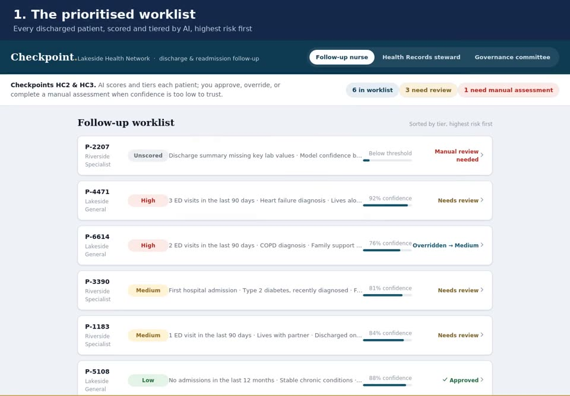

# Checkpoint — Who decides what, and when?

**🥈 2nd place of 10 finalists, 10Alytics Q3 Students Hackathon 2026 · Focus Area 2: AI and the Future of Work**
**Team Pod Nova (August cohort, Business Analysis):** Helena Delali Vormawor (team lead) · Phionah Atukunda, MPH, CHES® · Angela Eze · Olushola Omotosho

Checkpoint redesigns the discharge and follow-up workflow at **Lakeside Health Network**, a fictional network formed when two hospitals merged. The redesign lets humans and AI each own the decisions they're best placed to make.

The AI scores and sorts patients, and a named human makes every decision.

| | |
|---|---|
| ▶ **Live prototype** | [lenavon.github.io/10alytics-Hackathon---Checkpoint-](https://lenavon.github.io/10alytics-Hackathon---Checkpoint-/) |
| 🎬 **Demo video** (55 s) | [docs/Checkpoint_Demo.mp4](docs/Checkpoint_Demo.mp4) |
| 📊 **Pitch deck** (14 slides) | [PDF](docs/Checkpoint_Pitch_Deck.pdf) · [PowerPoint](docs/Checkpoint_Pitch_Deck.pptx) |
| 📄 **Business case** | [PDF](docs/Lakeside_Business_Case.pdf) · [Word](docs/Lakeside_Business_Case.docx) |

[](docs/Checkpoint_Demo.mp4)

> All patient data, costs and benefits are illustrative. These are not real patients or real results.

---

## The business problem

Lakeside General and Riverside Specialist have merged. The new network wants AI to predict which patients will be readmitted within 30 days of discharge, so that nurses can prioritise follow-up.

Building the model is the easy part. The hard part is deciding **who owns each decision once AI is in the loop.** Three issues stand in the way:

1. **Two systems, two processes.** Each hospital ran its own discharge workflow before the merger.
2. **Duplicate patient identities.** The same patient can exist under two different IDs, one at each hospital.
3. **No decision owner.** Nobody has defined which AI decisions can be automated and which need a human.

## Methodology

1. **Stakeholder analysis.** We mapped everyone the change affects and gave each decision exactly one accountable owner, using a RACI matrix.
2. **Process mapping.** We mapped the AS-IS discharge workflow at both hospitals and designed a TO-BE workflow with AI, both as swimlane diagrams.
3. **Decision-rights design.** We classified every decision as automated, AI-recommends or human-only.
4. **Requirements and validation.** We wrote a BRD, use cases and a traceability matrix, and planned a shadow pilot before go-live.

## The solution: four mandatory human checkpoints

```
Discharge ordered → Match patient identity → AI generates risk score → Nurse approves or overrides → Tailored follow-up
```

| Checkpoint | Trigger | Who decides | Why a human |
|---|---|---|---|
| **HC1** Identity match | Matching rules return an uncertain match | Health Records data steward | A wrong merge mixes two patients' histories |
| **HC2** Low-confidence case | Data is incomplete or confidence falls below the threshold | Follow-up nurse | The AI should not guess when the evidence is thin |
| **HC3** Tier review | Every tier the AI assigns | Follow-up nurse | Clinical accountability stays with a person |
| **HC4** Governance review | Monthly, and after any safety event | Clinical governance committee | Oversight of drift, fairness and safety |

### Governance model: three levels of automation

- **A. Automate.** The system acts on its own. This applies only to rule-based, reversible actions with no direct effect on care, and every action is logged.
- **B. AI recommends, human approves.** A named person must confirm before anything happens.
- **C. Human decides.** The AI may show information but never chooses.

All ten decisions are classified in Section 4.5 of the business case.

## Options analysis

| Option | Recommended? |
|---|---|
| A. Do nothing | No. High-risk patients continue to be missed |
| B. Harmonise the process only, with no AI | No. Misses the brief's core ask |
| **C. Checkpoint: AI-supported, human-in-the-loop** | **Yes** |
| D. Full automation | No. Removes clinical accountability |

## Business case at a glance *(illustrative)*

| Measure | Value |
|---|---|
| One-time investment | CAD 1.09M |
| Annual tangible benefit | CAD 1.40M (avoided readmissions, nurse time saved, records rework avoided) |
| Payback | ~11–12 months from go-live |
| 3-year cumulative net benefit | CAD 2.285M |
| Simple 3-year return | ~210% |
| Time to supervised go-live | 28 weeks, gated by a 20-week shadow pilot |

**Recommendation:** proceed with a shadow pilot to prove the decision model and the benefit case before investing further.

## The prototype

`index.html` is a self-contained clickable prototype with three role views:

- **Follow-up nurse.** A prioritised worklist with risk tiers, model confidence and plain-language risk drivers. The nurse approves or overrides each tier, choosing a reason code, and low-confidence cases are routed to manual assessment (HC2 and HC3).
- **Health Records steward.** Probable duplicate records from the two sites, shown side by side with a match score, so the steward can confirm or reject each merge (HC1).
- **Governance committee.** A monthly view of overrides and unscored cases (HC4).

Every action is logged and reversible. The prototype is built with vanilla HTML, CSS and JavaScript, so there's no build step: open `index.html` in a browser.

## Repository contents

```
index.html                         Clickable prototype
docs/Checkpoint_Demo.mp4           Recorded walkthrough of the prototype
docs/Checkpoint_Pitch_Deck.pdf     14-slide pitch deck (also available as .pptx)
docs/Lakeside_Business_Case.pdf    Full business case with BRD, use cases and traceability (also available as .docx)
```

## Skills demonstrated

Stakeholder analysis and RACI · AS-IS / TO-BE process mapping · decision-rights and AI governance design · options analysis · cost-benefit analysis · business, functional and non-functional requirements · use cases and traceability · change-impact analysis · risk management · UX prototyping

---


